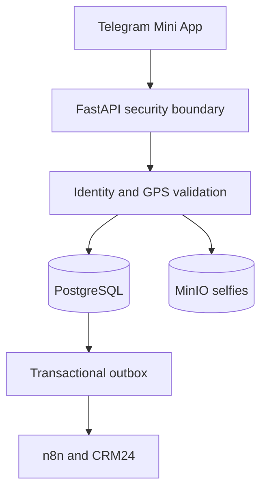

# Secure Telegram Attendance & Workforce Automation

> Public architecture case study for a private production-oriented employee attendance system. Source code, credentials, customer data, and operational configuration are intentionally not published.

## The challenge

Ordinary attendance forms trust the device clock, a single location reading, and a user-entered identity. That is not sufficient for field teams working across a headquarters and multiple project locations. The system needed a stronger audit trail while remaining quick enough to use inside Telegram.

## Delivered solution

HamavaYar is a mobile-first Telegram Mini App that validates the Telegram session on the server, collects multiple fresh GPS samples, evaluates accuracy and geofence policy, requires a live selfie, and records only unambiguous attendance decisions.

## Key capabilities

- Server-side Telegram Mini App session verification
- Multi-sample GPS collection with freshness and accuracy validation
- Project-aware geofencing and configurable operating policy
- Mandatory live selfie for check-in and check-out
- Server-generated timestamps and Persian/RTL mobile experience
- S3-compatible private object storage for attendance evidence
- Transactional outbox for resilient automation and CRM delivery
- Clear rejection paths that avoid writing ambiguous attendance events
- Automated API, build, lint, and rendered-output checks

## Engineering decisions

| Decision | Reason |
|---|---|
| Core API owns attendance decisions | Security-critical logic remains deterministic and testable |
| Multiple GPS samples | Reduces dependence on a single noisy location reading |
| CRM configuration is read, not blindly trusted | Project policy is normalized before enforcement |
| Transactional outbox | Attendance persistence does not depend on CRM or workflow availability |
| Private object storage | Selfies are not exposed as public application assets |
| Same-origin application boundary | Simplifies session handling and reduces avoidable browser exposure |

## Technology

| Layer | Stack |
|---|---|
| Mini App | Next.js, React, TypeScript, Tailwind CSS |
| Core API | Python, FastAPI, Pydantic, asyncpg |
| Data | PostgreSQL, MinIO/S3 |
| Automation | n8n, Telegram Bot API, CRM24/Vtiger |
| Delivery | Docker Compose, Caddy/TLS, CI checks |

## My contribution

- Translated operational attendance rules into enforceable backend policy
- Designed the API, data, storage, automation, and deployment boundaries
- Implemented the Telegram identity, GPS, geofence, and selfie workflow
- Integrated CRM directory/project data and reliable downstream events
- Prepared testing, security documentation, Docker deployment, and pilot checks

## Confidentiality

This repository is a portfolio case study, not the application source. It demonstrates system design and delivery scope without publishing employee records, private endpoints, secrets, proprietary workflows, or customer infrastructure details.
